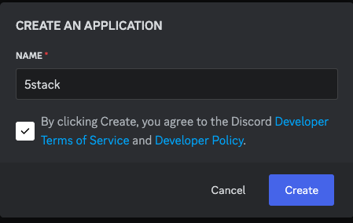
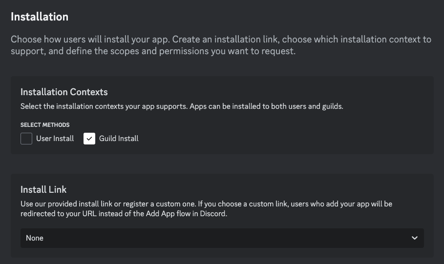
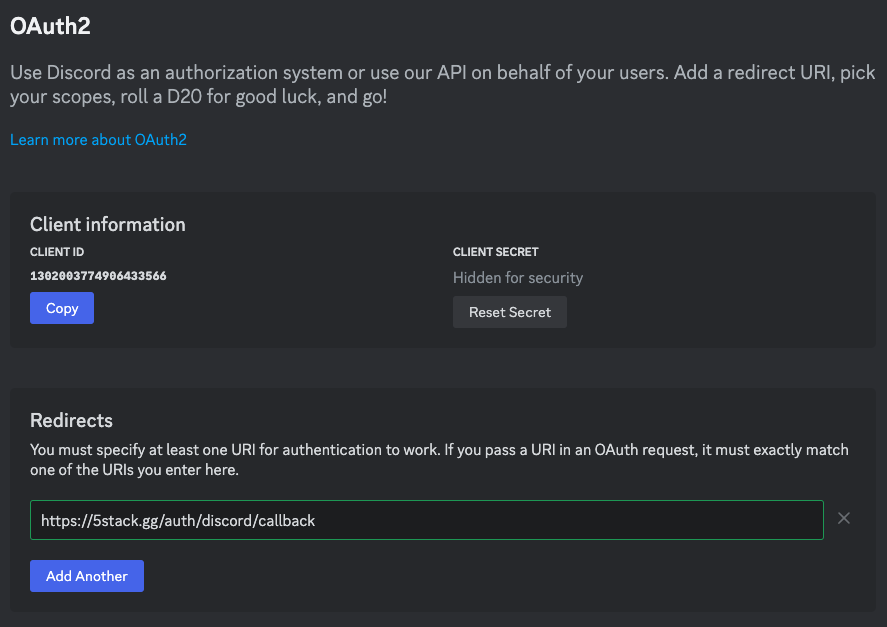
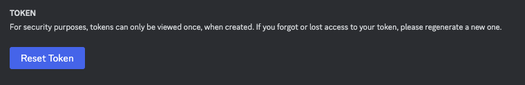
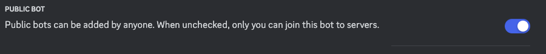

# 5Stack Discord Bot

5Stack includes a Discord bot that can be used to manage your server and provide additional functionality.

## What it does

The bot creates 5Stack matches from the players sitting in a Discord voice channel:

| Command        | Creates                                                                |
| -------------- | ---------------------------------------------------------------------- |
| `/competitive` | A Competitive match                                                    |
| `/wingman`     | A Wingman match                                                        |
| `/duel`        | A Duel match                                                           |
| `/rush`        | A Rush match                                                           |
| `/link`        | Not a match: links your Discord account to 5Stack for stat tracking    |

The match commands take the players from the voice channel you're in, or the one you pick with `team-selection`, which needs enough people for the format (10 for Competitive, 4 for Wingman, 2 for Duel, 6 for Rush). Lineups are random unless you turn on `captains` (optionally naming `captain-1` and `captain-2`), in which case the captains pick. Other options set `knife`, `overtime`, the `map` or a `custom-map-pool`, and `mr` (MR3, MR8, MR12 or MR15).

The bot then opens a thread for the match, runs the map veto with buttons, posts match status updates, and makes a voice channel for each team and moves the players into them.

Tournaments can use the bot for voice too: with a **Discord Server ID** under a tournament's **Voice Channels** settings, it creates channels for tournament matches and moves players into their team's channel when a match begins.

What gets posted to your Discord as notifications is configured separately; see [Integrations](/features/admin/integrations#discord).

## Guide

First. You need to create a new application in the [Discord Developer Portal](https://discord.com/developers/applications).

1. New Application
   

2. Installation Tab

   Only allow Guild Installs and set Install link to `none`

   

3. Oauth Tab

   
   - Update the Redirect URL to your `WEB_DOMAIN` URL, which can be found in `INSTALL_DIR/overlays/config/api-config.env`.
   - Update the `INSTALL_DIR/overlays/local-secrets/discord-secrets.env`. You need to update both the `DISCORD_CLIENT_ID` and `DISCORD_CLIENT_SECRET`.

4. Bot Tab
   1. You will need to reset the bot token to get a new one.

   

   In the file `INSTALL_DIR/overlays/local-secrets/discord-secrets.env`. You need to update the `DISCORD_BOT_TOKEN`.
   2. Disable Public Bot

   

5. Update the Panel

See [Update Guide](/updating) for instructions on updating the panel.

6. Invite the Bot to your Server

The Discord Bot can only be invited to a server by an administrator, and it can be accessed at the `WEB_DOMAIN` URL: `https://<WEB_DOMAIN>/discord-bot`.
