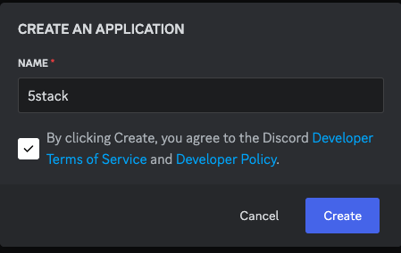
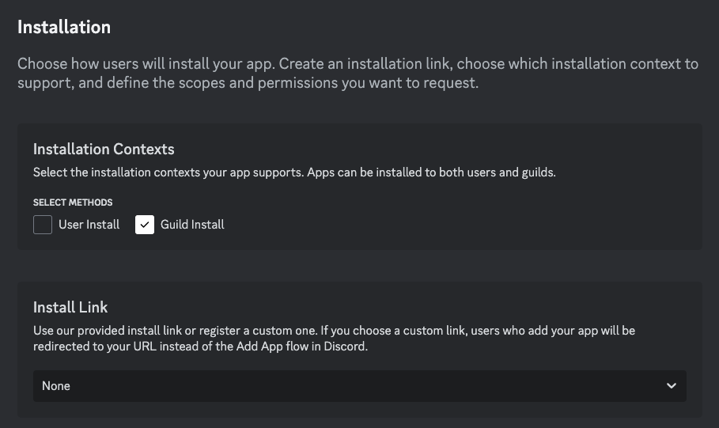
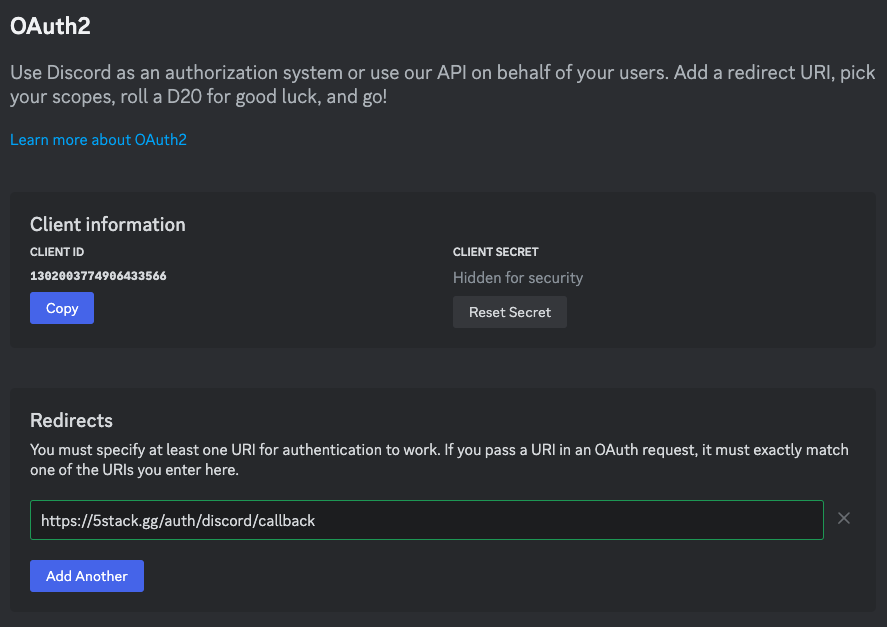
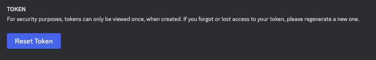
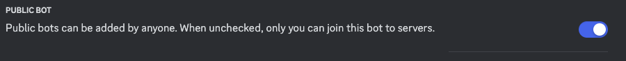

# 5Stack Discord Bot

5Stack includes a Discord bot that can be used to manage your server and provide additional functionality.

## What it does

The bot creates 5Stack matches from the players sitting in a Discord voice channel:

| Command        | Creates                                                                |
| -------------- | ---------------------------------------------------------------------- |
| `/competitive` | A Competitive match                                                    |
| `/wingman`     | A Wingman match                                                        |
| `/duel`        | A Duel match                                                           |
| `/rush`        | A Rush match                                                           |
| `/link`        | Not a match: links your Discord account to 5Stack for stat tracking    |

The match commands take the players from the voice channel you're in, or the one you pick with `team-selection`, which needs enough people for the format (10 for Competitive, 4 for Wingman, 2 for Duel, 6 for Rush). Lineups are random unless you turn on `captains` (optionally naming `captain-1` and `captain-2`), in which case the captains pick. Other options set `knife`, `overtime`, the `map` or a `custom-map-pool`, and `mr` (MR3, MR8, MR12 or MR15).

The bot then opens a thread for the match, runs the map veto with buttons, posts match status updates, and makes a voice channel for each team and moves the players into them.

Tournaments can use the bot for voice too: with a **Discord Server ID** under a tournament's **Voice Channels** settings, it creates channels for tournament matches and moves players into their team's channel when a match begins.

What gets posted to your Discord as notifications is configured separately; see [Integrations](/features/admin/integrations#discord).

## Guide

First. You need to create a new application in the [Discord Developer Portal](https://discord.com/developers/applications).

1. New Application
   

2. Installation Tab

   Only allow Guild Installs and set Install link to `none`

   

3. Oauth Tab

   
   - Update the Redirect URL to your `WEB_DOMAIN` URL. `5stack config get WEB_DOMAIN` on the panel server shows it.
   - Copy the `DISCORD_CLIENT_ID` and `DISCORD_CLIENT_SECRET`. You set them in step 5.

4. Bot Tab
   1. You will need to reset the bot token to get a new one.

   

   Copy it as the `DISCORD_BOT_TOKEN`. You set it in step 5.
   2. Disable Public Bot

   

5. Set the secrets

On the panel server, run this and paste each value when it asks. They are typed hidden:

```bash
sudo 5stack config set DISCORD_CLIENT_ID= DISCORD_CLIENT_SECRET= DISCORD_BOT_TOKEN=
```

It shows the changes, asks, and applies the panel again. On a [Vault](/advanced/vault) install, set them in Vault instead.

6. Invite the Bot to your Server

The Discord Bot can only be invited to a server by an administrator, and it can be accessed at the `WEB_DOMAIN` URL: `https://<WEB_DOMAIN>/discord-bot`.
