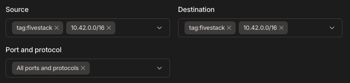
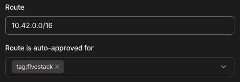
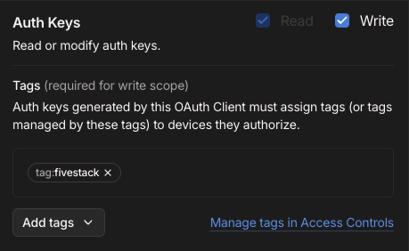
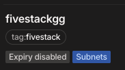

# Network / Tailscale Connectivity

If you are unable to obtain a Tailscale auth key when adding a new node to the panel, please check the following:

1. **Panel settings**

   On the panel server, check that these are present and correct:

   ```bash
   5stack config get TAILSCALE_CLIENT_ID
   5stack config get TAILSCALE_NODE_IP
   5stack config get TAILSCALE_NET_NAME
   ```

   - `TAILSCALE_CLIENT_ID` ([OAuth Settings](https://login.tailscale.com/admin/settings/oauth))
   - `TAILSCALE_NODE_IP` ([Machines](https://login.tailscale.com))
   - `TAILSCALE_NET_NAME` ([DNS Settings](https://login.tailscale.com/admin/dns))

   A panel set up on the setup page keeps its OAuth client in the 5Stack
   service, so `TAILSCALE_CLIENT_ID` can be empty there, and the panel still
   adds game server nodes.

   To set or replace the OAuth client, run `sudo 5stack config tailscale`. It
   checks the client with Tailscale before it saves anything.

   :::info
   You cannot view your secret after it has been created. If you lose your secret, generate a new OAuth client (see step 3) and run `sudo 5stack config tailscale` again.
   :::

2. **Tag / Access Controls / Auto Approvers**

   Make sure the tag exists and is allowed in [Access Controls](https://login.tailscale.com/admin/acls/visual/general-access-rules):

   

   Also, ensure the tag has an auto approver for the subnet in [Auto Approvers](https://login.tailscale.com/admin/acls/visual/auto-approvers):

   

3. **OAuth Client**

   Go to [OAuth Settings](https://login.tailscale.com/admin/settings/oauth) and ensure your client has the proper permissions:

   

4. **Verify Machine and Subnet Approval**

   Visit the [Machines](https://login.tailscale.com/admin/machines) page and ensure that all 5Stack machines and their associated subnets are approved.

   
