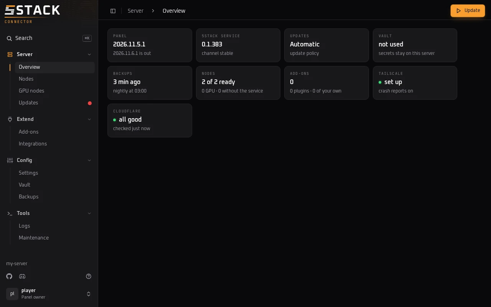
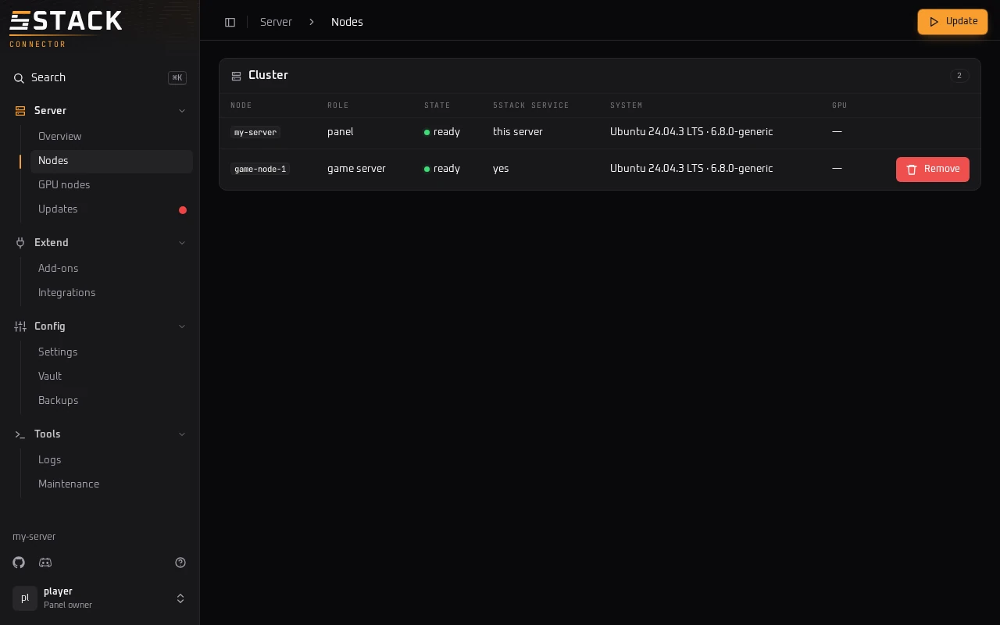
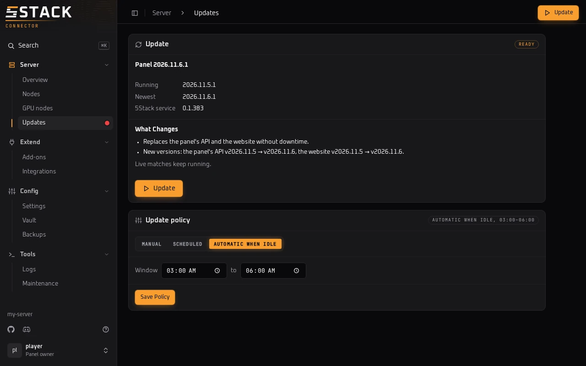
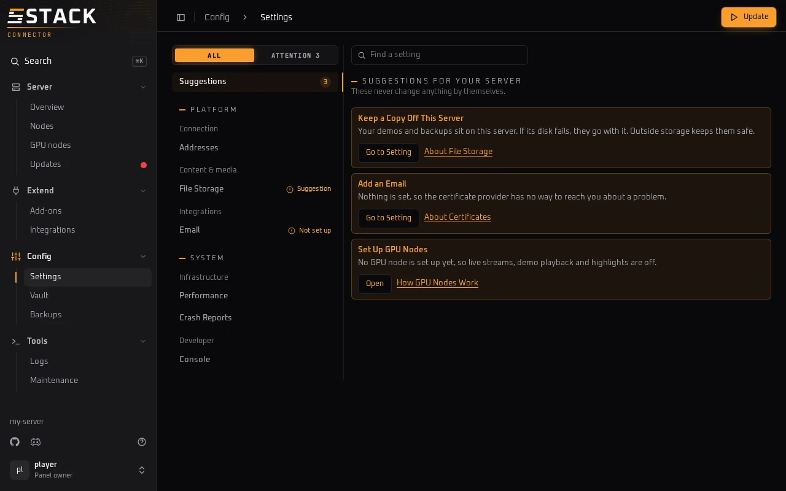
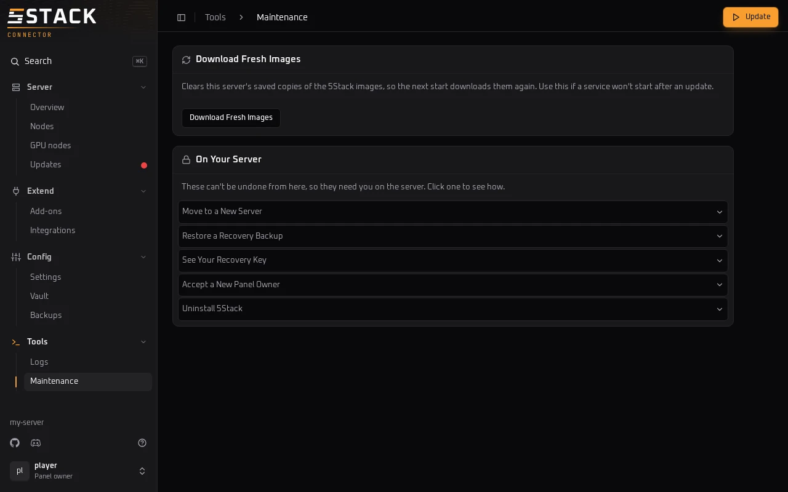

# Browser Console

The browser console is a page on `get.5stack.gg` where you, and the people you
add, manage your panel's server from your browser. Its tab says
**5Stack Connector**. You update the panel, change its settings, add plugins,
set up GPU nodes, look after backups and read logs, all with buttons, and
without keeping an SSH session open.

{.screenshot}

Use it for work on the server itself. Matches, players, game plugins and the
panel's own admin settings stay in your panel.

## Open it

Open it from 5stack.gg, or from the panel server. Either way, only people on
the panel's [People](/service/console-people) list can sign in to it.

### From 5stack.gg

1. On 5stack.gg, open **My Panels** from your user menu. It lists every panel
   you claimed or were added to, with your role on each.
2. Press **Open Console** next to the panel. It may ask you to sign in with
   Steam again first.
3. The console opens on get.5stack.gg and shows its progress: **Opened from
   5stack.gg**, then **Waking** the panel, then **Connecting**. It's usually
   ready within about 15 seconds. A panel that get.5stack.gg can't reach
   directly checks in every 5 minutes, so it can take up to that long. A panel
   that hasn't checked in for over an hour shows **Offline**.

Pressing **Open Console** on 5stack.gg is the approval. It works once, for that
panel and that request, within a few minutes, and only for someone on the
panel's list. Your server checks it itself before it opens anything, so neither
get.5stack.gg's pages nor its servers can open a console you didn't approve.
The key that unlocks your console travels once, in the part of the console's
address after `#`, which is removed as the page loads; it's only useful for a
few minutes, together with your 5stack.gg sign-in. This doesn't protect you if
5stack.gg itself is compromised, from a script running on 5stack.gg (such as a
plugin) while you're signed in, or from a compromised get.5stack.gg page once
the console is open, since the console runs there. If the approval doesn't
check out, the console says so and offers **Try Again**.

`get.5stack.gg/panels` now takes you to My Panels on 5stack.gg. A panel on an
older 5Stack service opens the console without the approval. `sudo 5stack ui`,
and a second tab joining a console that's already open, don't need the
approval.

The panel checks you against its own People list before it opens anything, so
get.5stack.gg can't add anyone. A console opened this way is yours alone, and
opening another one from 5stack.gg replaces it.

This works while **Allow opening from get.5stack.gg** is on. It's on by
default. An Admin turns it off on **Config → People**, or root runs
`sudo 5stack people web off` on the panel server. The console warns:

> While this is on, get.5stack.gg can open a console for anyone on this list,
> so turn it off if you don't trust 5Stack's cloud with that.

With it off, someone on the server opens the console with `sudo 5stack ui`.

### On the panel server

```bash
sudo 5stack ui
```

It prints a link to the console. Over SSH, it also copies the link to your
clipboard in terminals that allow it. Otherwise, copy the whole link, including
the part after `#`.

Leave the command running while you use the console.

Console links look like `https://get.5stack.gg/panels/<code>`. Older
`/ui/<code>` links still work.

### From your own computer

Install the `5stack` command on your Mac or Linux computer. It needs no sudo and
goes in `~/.local/bin`:

```bash
curl -fsSL https://get.5stack.gg | sh -s -- client
```

Then open the console of any panel you can SSH into, using a host from your SSH
config or `user@host`:

```bash
5stack ui my-server
```

It may ask for your sudo password on the server, then opens the console in your
browser. Ctrl+C ends the console.

### With `sudo 5stack`

On a claimed panel, `sudo 5stack` on its own opens the console too, and prints
its link. Press Enter to close it and open the
[terminal menu](/service/command#the-menu) instead, or Ctrl+C to close it.

## Sign in

The console asks you to sign in with Steam on 5stack.gg. The server checks that
account against its [People](/service/console-people) list, and you get the
role you have there: **Admin** or **Read only**. An account that isn't on the
list is refused.

A panel nobody has claimed yet can't open a console: `sudo 5stack ui` prints the
claim link instead. Claim it, then run `sudo 5stack ui` again.

## When it ends

A console closes when you press **End Session** in the account menu, at the
bottom of the sidebar, which takes you back to My Panels on
[5stack.gg](https://5stack.gg/panels). It also closes after 30
minutes idle, when an Admin removes you from People, or when root runs
`sudo 5stack ui --end`.

A console from `sudo 5stack ui` also closes when the terminal that opened it
closes or you press Ctrl+C there, or when someone runs `sudo 5stack ui` again.
One opened from get.5stack.gg also closes 8 hours after you signed in, when you
open another one from there, or when an Admin turns off
**Allow opening from get.5stack.gg**.

After it closes, the link stops working: open a new one from get.5stack.gg, or
run `sudo 5stack ui`.

## Why it's safe

- **5Stack can't read what you do.** Your browser and your server talk through
  get.5stack.gg encrypted end to end.
- **Your server decides who gets in.** It checks every sign-in against its own
  People list, so get.5stack.gg can't add anyone.
- **There's no box for commands.** You can't type a command for the server to
  run. Every button runs one of a fixed set of actions.
- **Changes ask first.** Before anything that restarts, installs or removes
  something runs, the page says what it affects, such as **No restart** or
  **Holds new matches until live matches finish**, and waits for you to
  confirm.
- **What can't be undone stays on the server.** Moving the panel, restoring a
  recovery backup, showing the recovery key, accepting a new owner and
  uninstalling aren't in the console. Maintenance shows how to do them on the
  server.
- **Everything is logged.** Each sign-in and everything run after it is in
  `journalctl -u 5stack`.

## Pages

The sidebar groups the pages. **Search**, or ⌘K or Ctrl+K, jumps to any page by
name. Read only people see every page, but the buttons that change something
are for Admins. See
[What Read only can't do](/service/console-people#what-read-only-can-t-do).

Anything you run shows its progress in a panel at the side, with **Stop** to
stop it. The console runs one thing at a time. When an update is out, or saved
settings are waiting, **Update** appears at the top of every page.

### Server

**Overview** shows the server at a glance: the panel's release, the 5Stack
service, updates, Vault, backups, nodes, add-ons, Tailscale and Cloudflare. Each
card opens its page.

**Nodes** lists every node: its role, whether it's ready, whether it has the
5Stack service, its system and its graphics card. **Remove** uninstalls 5Stack
from a game server node and takes it out of the panel. Nodes added with the old
install script get **Give Them the Service**.

{.screenshot}

**GPU nodes** finds the graphics cards on your nodes. Switch on the nodes to
use for streaming and clips, set the Steam account they sign in with and the
streaming address, then press **Apply Changes**. If it finds no cards,
**Set Up GPU Nodes** walks you through the brand, the nodes, the Steam account
and a review. See
[GPU Nodes](/servers/gpu-nodes/).

**Updates** shows the release you run and the newest one, and before you update,
what the update changes: which services restart, which versions change, and
whether it holds new matches. Pick the update policy here: **Manual**,
**Scheduled** or **Automatic When Idle**, with the time window. See
[Updating](/updating).

{.screenshot}

### Extend

**Add-ons** has three tabs. **Installed** opens, reinstalls or removes what you
have. **Browse** installs plugins from the plugin directory, or from a GitHub
link. **Your Own** starts, moves, stops and removes add-ons of your own, and
**Add From a File** uploads one as a `.zip` of up to 8 MB. An add-on runs with
full control of the server, so only upload one from someone you trust. Plugins
for your game servers are in your panel instead.

**Integrations** checks Cloudflare when the panel uses it: each address, the
settings 5Stack relies on, and suggestions such as Tiered Cache. It also sets up
and re-deploys the Cloudflare Workers 5Stack offers: the Backblaze proxy, the
Playcast edge relay and the stream edge relay. See
[Backblaze + Cloudflare](/advanced/s3/backblaze) and
[Playcast Edge Relay](/advanced/playcast-edge-relay).

### Config

**Settings** opens on suggestions for your server, which never change anything
by themselves. Every setting is grouped by what it's for, and
**Find a setting** searches them. Saving restarts nothing: the change applies
when you press **Update**. Crash reports and **Show Advanced Features**, which
shows the live log of updates as they run, switch on and off here. See
[Diagnostics](/service/diagnostics).

{.screenshot}

**People** lists who can use the console and their roles, holds the
**Allow opening from get.5stack.gg** switch, and shows Admins the console log.
See [Console People](/service/console-people).

**Vault** is for panels that keep their secrets in HashiCorp Vault. It shows
whether Vault answers, when it was checked and last synced, and any secret that
isn't syncing. **Check Now** checks again, and **Resync** and
**Add the Missing Secrets** fix what it finds. See
[HashiCorp Vault](/advanced/vault).

**Backups** has a tab for each kind of backup. **Database Backups** lists the
panel's nightly backups and restores one. **Recovery Backups** runs
**Back Up Now**, turns nightly recovery backups on, and shows how to restore one
or move to a new server. See [Backups](/install/backups).

Admins also get **Download** next to each recovery backup:

- It downloads the file exactly as it's stored on the server, still encrypted,
  so you need your [recovery key](/install/backups#the-recovery-key) to open it.
- Database backups have no download.
- When your browser can reach the panel's file storage, which is the usual
  case, it downloads the backup straight from there. Otherwise the backup comes
  through the console itself, which carries files up to 32 MB. A bigger backup
  can't come that way: copy it off the server from `/var/lib/5stack/backups`
  instead.

### Tools

**Logs** reads the logs of the 5Stack service, k3s and the panel's services.
Follow them live, filter by level or text, and download what you see.
**Make a Bundle** makes a debug bundle with player data removed, to download or
send to 5Stack.

**Maintenance** fixes certificates that aren't valid, and
**Download Fresh Images** helps when a service won't start after an update.
**On Your Server** lists what can't be undone from a browser, with the command
to run on the server.

{.screenshot}
