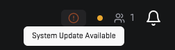

# Updating the 5Stack Panel

Occasionally you may need to update the 5Stack Panel to the latest version.
Currently, this process requires manual intervention:

1. Navigate to the installation directory.
2. Run `git pull` to fetch the latest updates.
3. Execute

```bash
./update.sh
```

## Database upgrades

The database is TimescaleDB on PostgreSQL. `update.sh` keeps it current in two
ways.

**TimescaleDB extension.** After a new TimescaleDB image rolls out, `update.sh`
updates the extension inside the database to the image's version and restarts
Hasura and the API if it moved. This happens without asking: it is a minor,
in-place update.

**A new PostgreSQL major version.** When the panel moves to a new PostgreSQL
major (for example from 17 to 18), `update.sh` upgrades the database in place
with `pg_upgrade` before it changes anything else. It first shows:

- the database's size and the node it lives on,
- the free disk and how much the upgrade needs: a full copy of the database,
  a margin, and the 5% k3s keeps free,
- the expected downtime (the copy runs at roughly 100 MiB/s; Hasura and the API
  error until the database is back),
- where the old data is kept for a rollback.

Then it asks **Stop timescaledb and upgrade it now? [y/N]**. Answering no stops
`update.sh` before anything has changed. If there is not enough disk, it stops
and says how much is missing.

::: tip Unattended updates
Without a terminal to ask on, `update.sh` refuses to upgrade the database. Pass
`--yes` (or set `ASSUME_YES=true`) to upgrade unattended.
:::

The upgrade copies the data rather than moving it, so the old PostgreSQL data
stays on the node as `timescaledb-pgNN` (for example `timescaledb-pg17`) next to
the live database. When it finishes, `update.sh` prints the commands to roll
back to it, and the command to delete it once the new version has proven
itself. Rolling back loses anything written since the upgrade.

## Updating 5Stack Components

The 5Stack Panel can update its components (API, Web, Game Server Node Connector, etc.) through the update interface at the top of the application.


